# 🛢️ Palm Oil Refinery Operations Analytics

**An end-to-end data analytics project: messy plant data → SQL data model → data mining → Excel & Power BI dashboard.**


> **🔗 [Live interactive dashboard](https://farhananasaruddin.github.io/palm-oil-refinery-analytics/dashboard/)** ·
> 📄 [Insights report](docs/insights_report.md) · 📊 [Excel workbook](excel/Refinery_Analysis.xlsx) · 🟨 [Power BI kit](powerbi/)

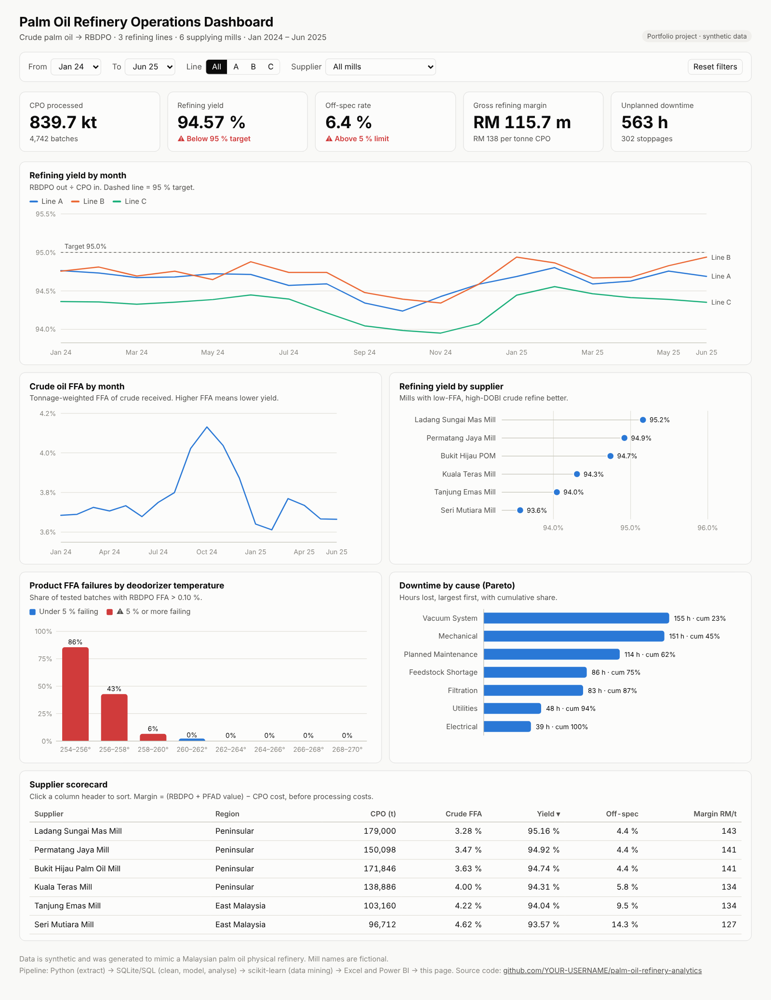

---

## 📌 Business problem

A palm oil refinery turns **crude palm oil (CPO)** into **refined, bleached & deodorized palm oil (RBDPO)**
and a by-product, **palm fatty acid distillate (PFAD)**. The refinery has three lines and buys crude from six mills.
For the last 18 months it has missed both of its targets:

- **Refining yield** of 94.57 % against a 95 % target. At about 560 kt of CPO a year, each 0.1 point of yield is about 560 t of RBDPO, or roughly RM 2.3 m a year.
- **Off-spec rate** of 6.4 % against a 5 % limit. Off-spec product must be reprocessed or sold at a discount.

**Questions:** What drives yield? Where does off-spec product come from? Which suppliers are worth paying more for?
Which equipment fails most?

As a **Chemical Engineering graduate**, I used process knowledge (mass balances, FFA chemistry, deodorizer operation)
to decide which questions to ask and which patterns in the data were physically meaningful.

## 💡 Key findings

| # | Finding | Evidence |
|---|---|---|
| 1 | **Every +1 % FFA in the crude costs 1.06 points of yield** | Multiple regression, R² = 0.93 |
| 2 | **Supplier quality gap is worth about RM 20 m** over 18 months | SQL benchmark vs the best mill |
| 3 | **Line C makes 77 % of off-spec batches.** Its deodorizer runs about 2 °C colder with weaker vacuum | SQL pivot + Random Forest (AUC 0.97) |
| 4 | **Below 258 °C, 43 to 86 % of batches fail the FFA spec.** At 260 °C and above, under 0.5 % fail | Temperature banding |
| 5 | **Vacuum and mechanical faults cause 45 % of downtime.** Line C's MTBF is 78 h vs 180 to 219 h on Lines A and B | Pareto + reliability KPIs |

➡️ Full analysis and six costed recommendations: **[docs/insights_report.md](docs/insights_report.md)**

---

## 🔄 Pipeline

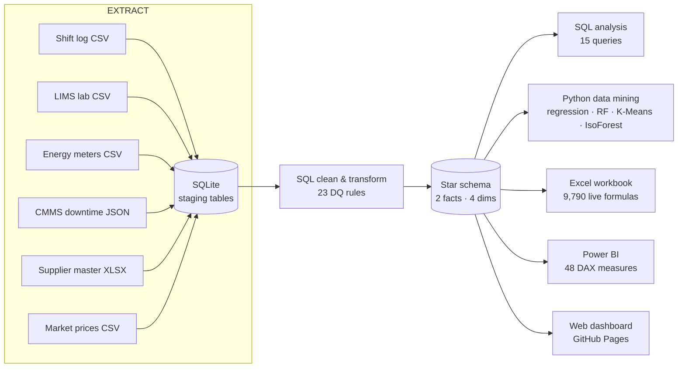

| Stage | Tools | Where |
|---|---|---|
| 1. Extract & load | Python (pandas, json, openpyxl) | [`python/02_extract_load.py`](python/02_extract_load.py) |
| 2. Clean & transform | SQL (CTEs, window functions) | [`sql/02_clean_transform.sql`](sql/02_clean_transform.sql) |
| 3. Data model | SQL star schema | [`sql/01_schema.sql`](sql/01_schema.sql), [`sql/04_reporting_views.sql`](sql/04_reporting_views.sql) |
| 4. Analysis | SQL | [`sql/03_analysis_queries.sql`](sql/03_analysis_queries.sql) → [`outputs/sql_results/`](outputs/sql_results) |
| 5. Data mining | Python (scikit-learn, scipy) | [`python/04_data_mining.py`](python/04_data_mining.py) → [`outputs/data_mining/`](outputs/data_mining) |
| 6. Excel | Formulas, conditional formatting, charts | [`excel/Refinery_Analysis.xlsx`](excel/Refinery_Analysis.xlsx) |
| 7. Power BI | Power Query (M), DAX, theme | [`powerbi/`](powerbi) |
| 8. Publish | HTML/JS (no libraries) on GitHub Pages | [`dashboard/index.html`](dashboard/index.html) |

---

## 1️⃣ Extract

Six sources in three formats, the way plant data really arrives: DCS and shift-log CSVs, a LIMS export, a **nested JSON**
from the maintenance system, and an **Excel** supplier master. Everything is loaded into `stg_*` tables **as text**.
No data is changed at this stage, so every later fix is visible and traceable.

## 2️⃣ Clean & transform (SQL)

Profiling found these problems. Every rule is logged in a `dq_log` table, and every repaired row carries a `dq_flags` audit trail.

| Issue found in the raw data | Rows | Fix |
|---|---:|---|
| Duplicate batch records | 71 | `ROW_NUMBER()` de-duplication |
| 3 date formats (`2024-05-01`, `01/05/2024`, `01-May-2024`) | 1,355 | `GLOB` pattern + parse |
| Line labels `Line A` / `LINE-A` / `line a` / `A` | 2,355 | Standardise to `A/B/C` |
| Supplier typos (`Kuala Terass`, `Tg. Emas`, `Bukit Hijau POM`) | 3,207 | Alias mapping table |
| FFA keyed as a fraction (0.038 instead of 3.8 %) | 94 | Engineering range rule, × 100 |
| Temperature with the decimal point lost (2625 °C) | 22 | ÷ 10 |
| Missing CPO input or RBDPO output | 41 | ⚗️ **Mass-balance back-calculation** (CPO = RBDPO + PFAD + median loss) |
| Lab re-tests, `<0.03` detection limits, `2.8R` units | 1,058 | Keep latest test, parse text |
| Electricity in MWh and kWh mixed | 257 | Unit harmonisation |

Full log: [`outputs/sql_results/q15_data_quality_summary.csv`](outputs/sql_results/q15_data_quality_summary.csv)

## 3️⃣ Data model

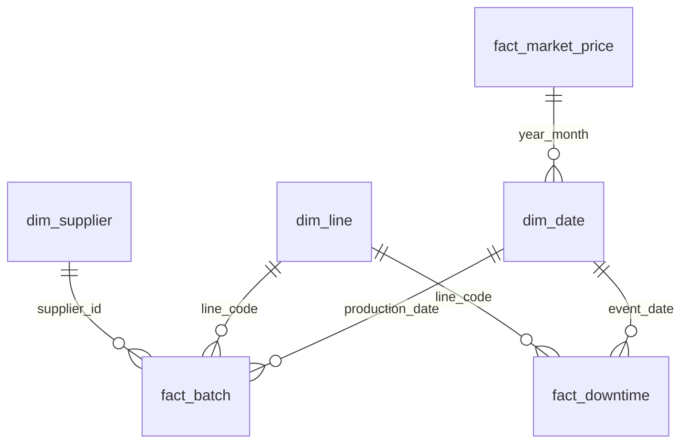

`fact_batch` has one row per batch: feedstock quality, process conditions, outputs, lab quality and utilities.
`fact_downtime` has one row per stoppage.

## 4️⃣ SQL analysis

Fifteen business questions, each answered by one tagged query. For example, the downtime Pareto uses a running-total window:

```sql
SELECT category, events, ROUND(hours, 1) AS hours,
       ROUND(100.0 * hours / SUM(hours) OVER (), 1) AS pct_of_total,
       ROUND(100.0 * SUM(hours) OVER (ORDER BY hours DESC ROWS UNBOUNDED PRECEDING)
             / SUM(hours) OVER (), 1)                AS cumulative_pct
FROM (SELECT category, COUNT(*) AS events, SUM(duration_min) / 60.0 AS hours
      FROM fact_downtime GROUP BY category);
```

Techniques used: CTEs · `LAG` · `RANK` · `NTILE` · moving averages (`ROWS BETWEEN 6 PRECEDING`) · z-score outliers ·
pivots with conditional aggregation · CASE banding · recursive CTE date dimension.

## 5️⃣ Data mining

| Method | Question | Result |
|---|---|---|
| Multiple linear regression | What drives yield? | FFA −1.06 pts per %, bleaching earth −0.41 pts per %, Line C −0.29 pts (R² 0.93) |
| Random Forest + permutation importance | Can we predict off-spec before it happens? | ROC AUC **0.97**, recall 87 %. #1 driver is deodorizer temperature |
| K-Means (silhouette-checked) | Which natural crude-quality grades exist? | Premium / Standard / Challenging: 95.1 / 94.4 / 93.7 % yield |
| Isolation Forest | Which batches used abnormal energy? | 48 batches flagged for energy audit |

| | |
|---|---|
| 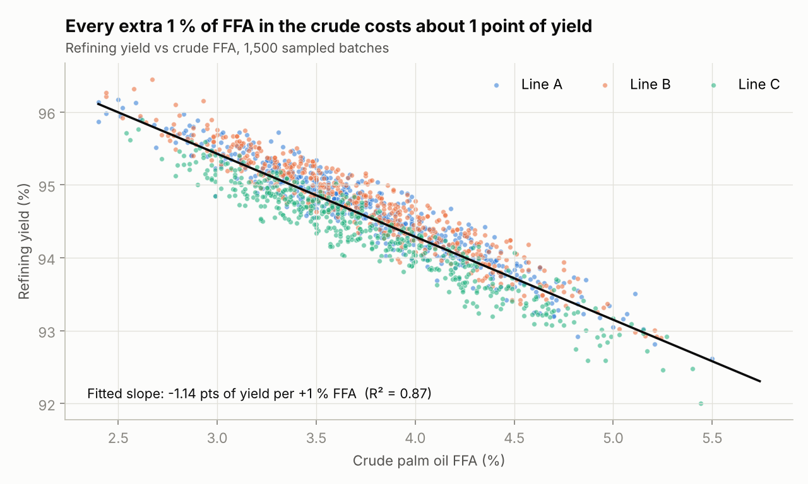 | 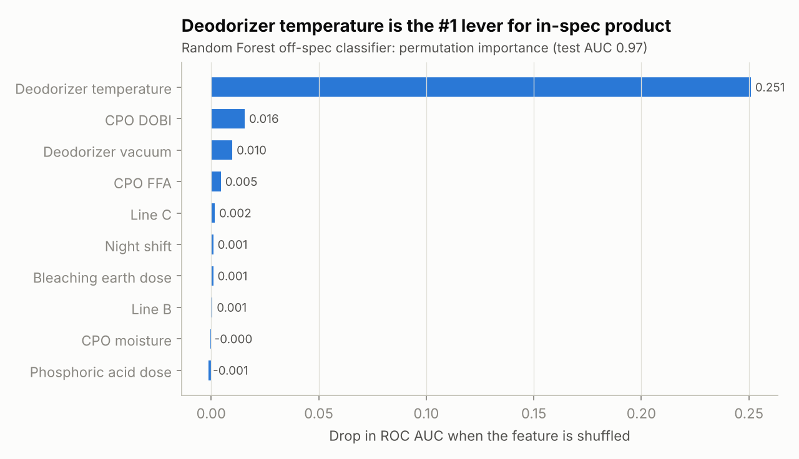 |
| 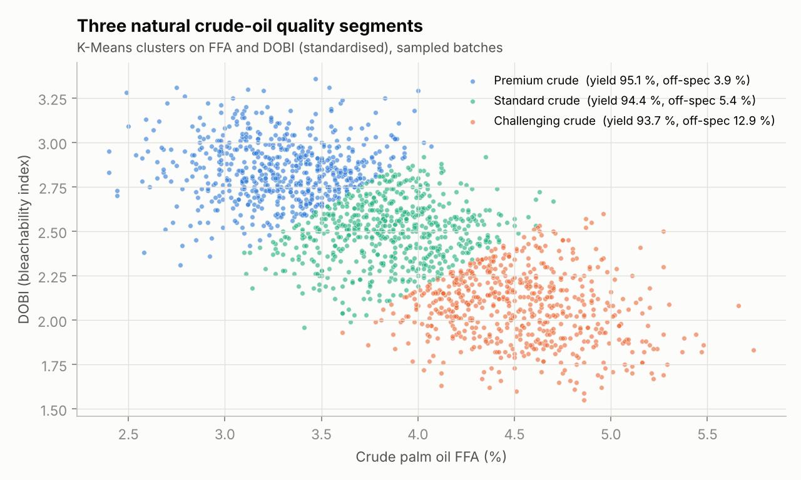 | 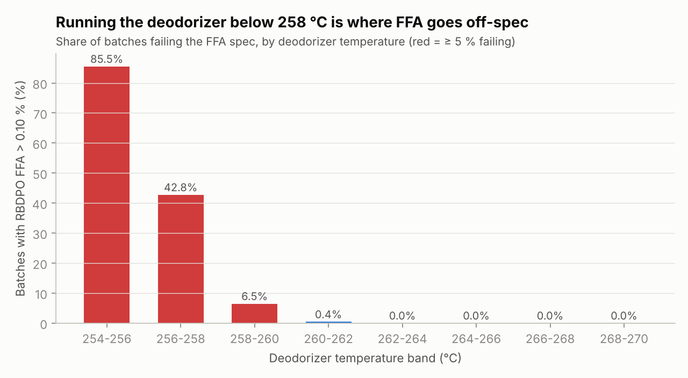 |
| 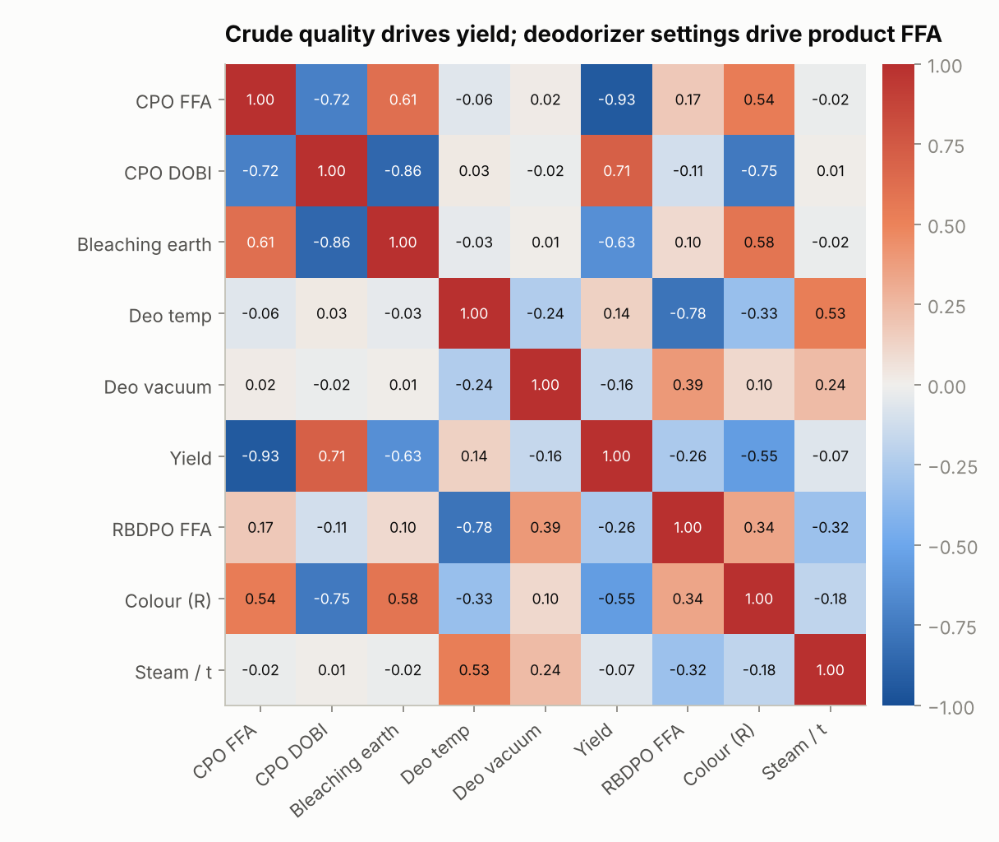 | 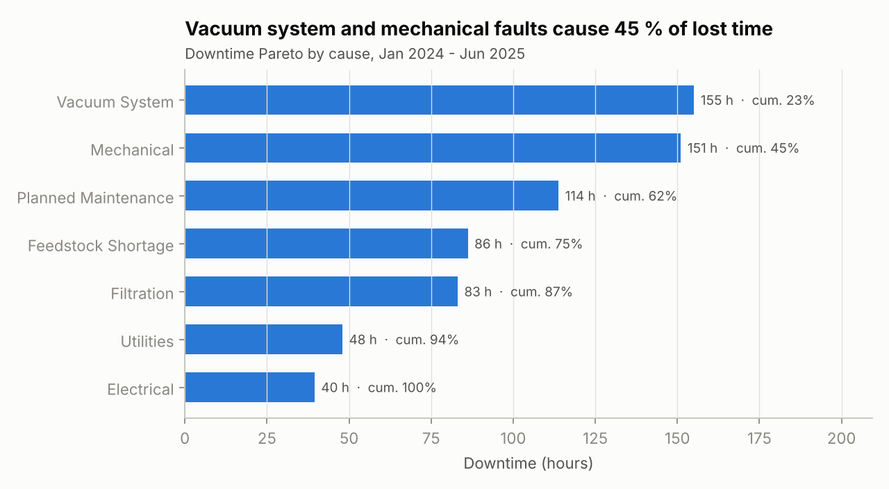 |

## 6️⃣ Excel workbook

[`excel/Refinery_Analysis.xlsx`](excel/Refinery_Analysis.xlsx) has 11 sheets and **9,790 live formulas, with no hard-coded results**:

- **Assumptions** sheet with spec limits and prices as inputs. Change the FFA spec and every KPI recalculates.
- `SUMIFS` / `COUNTIFS` / `SUMPRODUCT` weighted averages · `RANK` · `INDEX/MATCH` · `SLOPE` / `RSQ`
- Excel Table with calculated columns, colour scales, data bars and native charts
- Raw data sample, cleaning log and data dictionary for transparency

## 7️⃣ Power BI

The [`powerbi/`](powerbi) folder contains everything needed to build the 5-page report:
- [`power_query/all_queries.m`](powerbi/power_query/all_queries.m): parameterised CSV import, typing and banding columns
- [`DAX_measures.dax`](powerbi/DAX_measures.dax): 48 measures (yield, off-spec, margin via `RELATED` across the model, time intelligence, `RANKX`, Pareto cumulative %, MTBF/MTTR)
- [`refinery_theme.json`](powerbi/refinery_theme.json): a colour-blind-safe report theme
- [`BUILD_GUIDE.md`](powerbi/BUILD_GUIDE.md): page-by-page layout, Key Influencers AI visual, and publishing steps

| Executive Overview | Quality & Process |
|---|---|
| 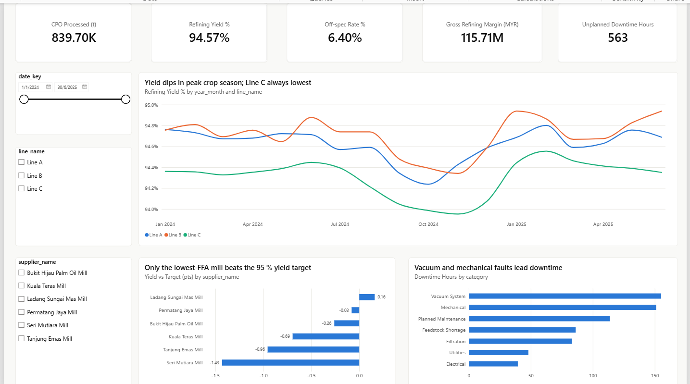 | 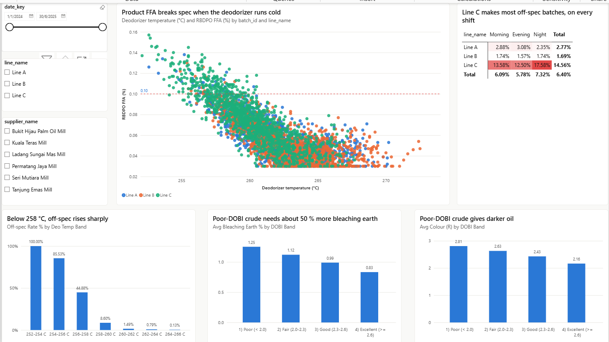 |
| **Supplier Analysis** | **Off-spec Drivers (AI)** |
| 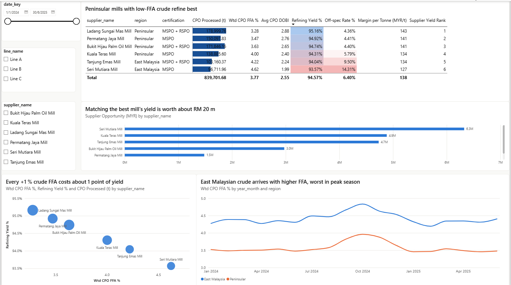 | 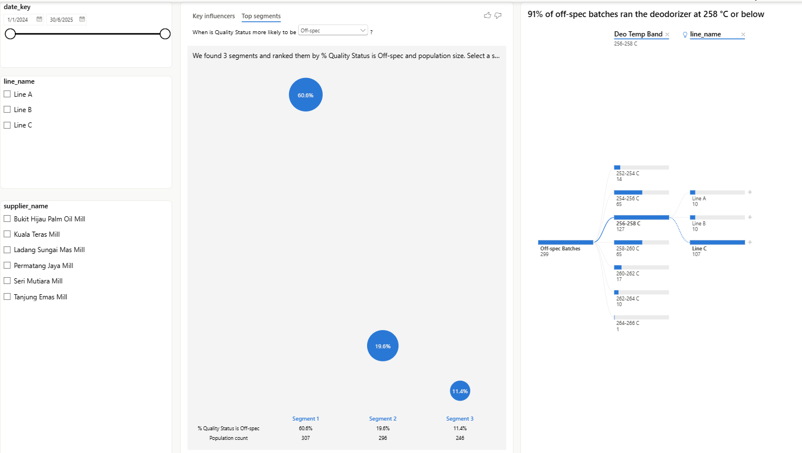 |
| **Reliability & Energy** | |
| 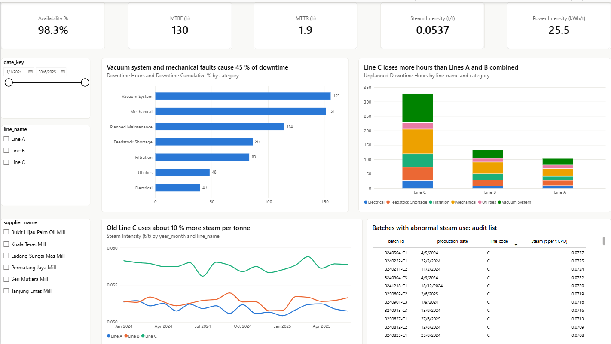 | |

📄 [Full report as PDF](powerbi/Refinery_Operations.pdf)

## 8️⃣ Publish

The [web dashboard](dashboard/index.html) is a single HTML file with no libraries. It supports period, line and supplier filters,
hover tooltips, a sortable scorecard and dark mode, and it is hosted free on GitHub Pages.

---

## ▶️ Run it yourself

```bash
git clone https://github.com/farhananasaruddin/palm-oil-refinery-analytics.git
cd palm-oil-refinery-analytics
pip install -r requirements.txt
python run_pipeline.py          # about 1 minute; rebuilds everything from raw data
```

The SQL is written in SQLite and uses portable ANSI syntax. To run it on **SQL Server**, replace `GLOB` with `LIKE '[0-9]...'`,
`julianday()` with `DATEDIFF`, `printf` with `FORMAT`, and `||` with `+` or `CONCAT`. On **MySQL**, use `STR_TO_DATE` for the date parsing.

## 📁 Repository structure

```
├── data/
│   ├── raw/                 # 6 messy source files (CSV, JSON, XLSX)
│   └── processed/           # clean star-schema tables (CSV) → Power BI & Excel source
├── sql/
│   ├── 01_schema.sql        # star schema DDL
│   ├── 02_clean_transform.sql   # 23 cleaning rules + dq_log
│   ├── 03_analysis_queries.sql  # 15 business questions
│   └── 04_reporting_views.sql   # semantic layer views
├── python/                  # 01 generate → 02 extract → 03 SQL runner → 04 mining → 05 Excel → 06 web
├── excel/Refinery_Analysis.xlsx
├── powerbi/                 # DAX, Power Query M, theme, build guide
├── dashboard/index.html     # interactive web dashboard (GitHub Pages)
├── outputs/                 # SQL query results, model outputs
├── images/                  # charts used in this README
├── docs/insights_report.md  # findings & recommendations
└── run_pipeline.py
```

## ⚠️ About the data

The data is **synthetic**, because real refinery data is confidential. I wrote a generator
([`python/01_generate_raw_data.py`](python/01_generate_raw_data.py)) that builds in real process relationships:
FFA leaves as PFAD, low DOBI needs more bleaching earth, and a colder deodorizer leaves more FFA in the product.
It also adds realistic data-quality problems. The analysis then had to **rediscover** those relationships from noisy,
messy data, which is a useful test that the methods work. Mill names are fictional, and prices are illustrative MYR values.

## 👤 About me

**Norfarhana Mohd Nasaruddin**: Chemical Engineering graduate moving into data analytics, combining process-engineering knowledge with
SQL, Python, Excel and Power BI.
[LinkedIn](https://linkedin.com/in/farhananasaruddin) · [Email](mailto:farhana.nasaruddin2@gmail.com)
