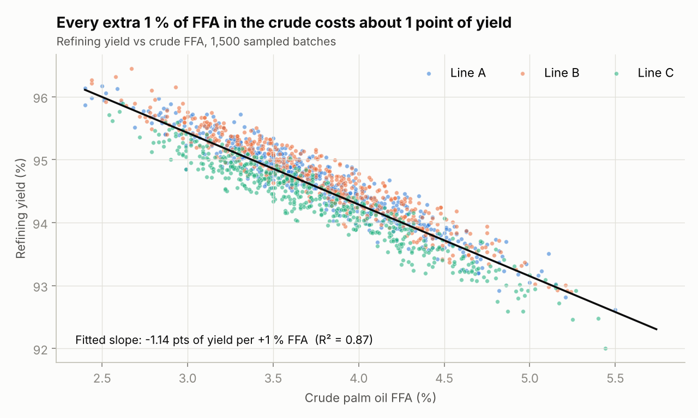
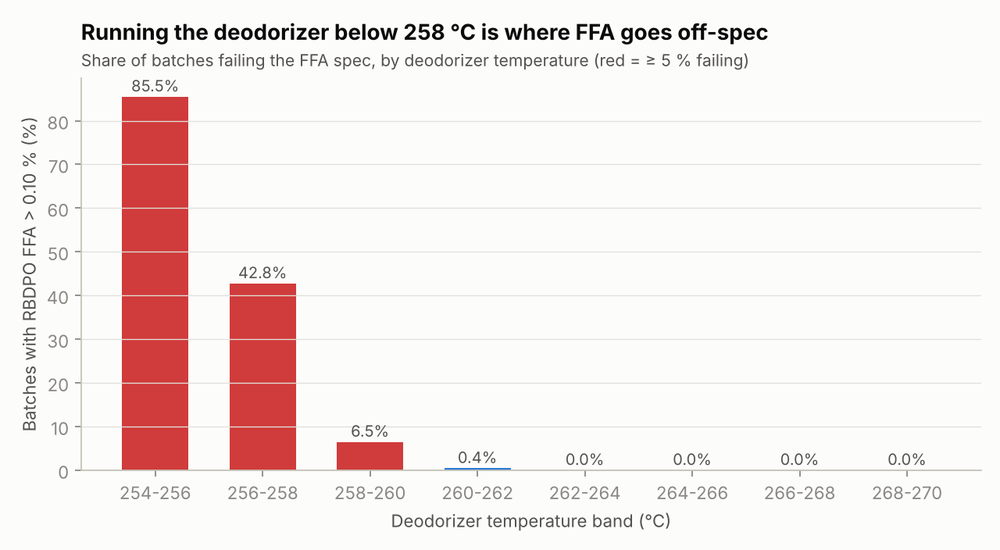
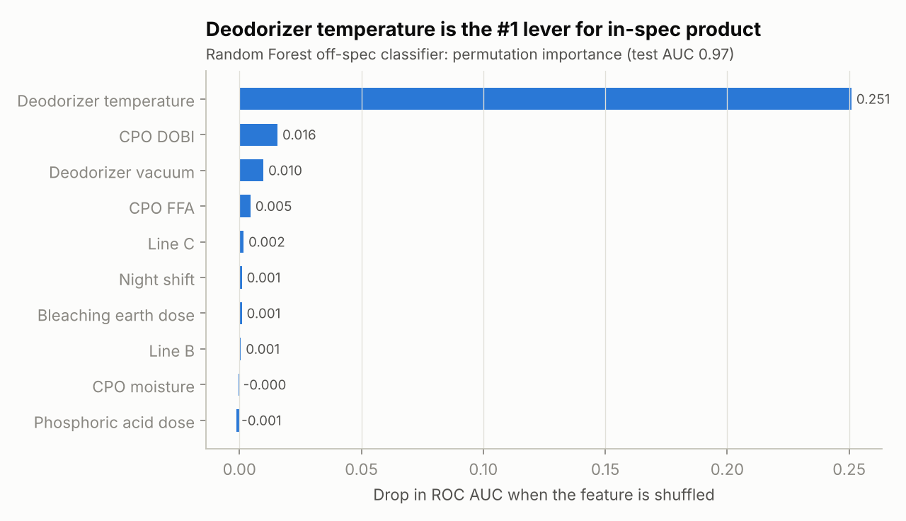
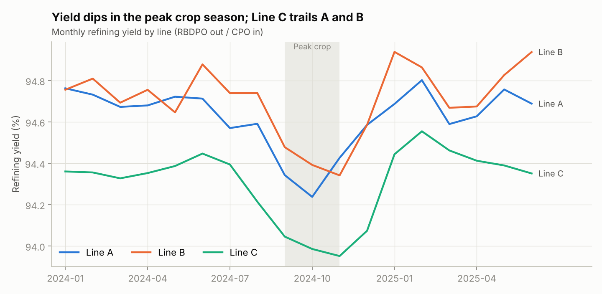
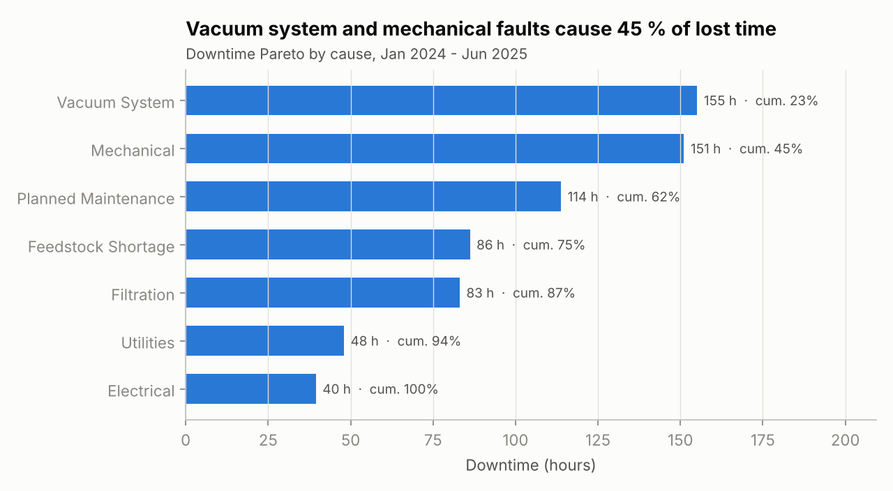

# Insights & Recommendations

**Scope:** 4,742 refining batches, 3 lines, 6 supplying mills, and 320 downtime events from Jan 2024 to Jun 2025.
**Audience:** Refinery manager, process engineering, procurement.
**Data:** Synthetic. It was generated to mimic a Malaysian palm oil physical refinery (see README).

---

## Executive summary

| KPI | Result | Target | Status |
|---|---|---|---|
| CPO processed | 839.7 kt | – | – |
| Refining yield (RBDPO / CPO) | **94.57 %** | 95.0 % | ⚠ Below |
| Off-spec rate | **6.4 %** (299 batches) | ≤ 5 % | ⚠ Above |
| Gross refining margin* | RM 115.7 m (RM 138 / t) | – | – |
| Unplanned downtime | 563 h | – | – |

\* Product value (RBDPO + PFAD) minus CPO cost at monthly prices. Processing costs are excluded.

The refinery misses both targets. Two root causes explain most of the gap:

1. **Crude oil quality** drives yield. It depends on which mill supplied the crude and on the season.
2. **Line C's deodorizer conditions** cause most of the off-spec product.

---

## Finding 1: Every +1 % FFA in the crude costs about 1.06 points of yield

- Multiple linear regression: R² = 0.93, n = 4,705. The FFA coefficient is **−1.061 points of yield per +1 % FFA**
  (p < 0.001), holding DOBI, moisture, bleaching earth, line and shift constant.
- This fits the process. In physical refining, the free fatty acids leave the deodorizer as PFAD,
  so FFA that comes in with the crude cannot become RBDPO.
- By FFA band, yield falls from **95.6 % (FFA < 3 %)** to **93.0 % (FFA ≥ 5 %)**, and margin falls from RM 150 to RM 115 per tonne.
- **What it is worth:** cutting crude FFA by 1 point on 100,000 t of CPO gives about 1,060 t more RBDPO,
  or roughly **RM 4.4 m** at the average RBDPO price.

## Finding 2: Supplier choice is a RM 20 m question

| Mill | Region | Crude FFA | DOBI | Yield | Off-spec |
|---|---|---|---|---|---|
| Ladang Sungai Mas | Peninsular | 3.28 % | 2.88 | **95.16 %** | 4.4 % |
| Permatang Jaya | Peninsular | 3.47 % | 2.76 | 94.92 % | 4.4 % |
| Bukit Hijau | Peninsular | 3.63 % | 2.65 | 94.74 % | 4.4 % |
| Kuala Teras | Peninsular | 4.00 % | 2.40 | 94.31 % | 5.8 % |
| Tanjung Emas | East Malaysia | 4.22 % | 2.24 | 94.04 % | 9.5 % |
| Seri Mutiara | East Malaysia | 4.62 % | 1.99 | **93.57 %** | 14.3 % |

- The two East Malaysian mills are 1,100 to 1,650 km away. They deliver the highest-FFA, lowest-DOBI crude,
  probably because of longer storage and transport time.
- If every mill matched the best mill's yield, the refinery would have gained about **5,000 t of RBDPO, or about RM 20.4 m over 18 months**
  (`sql/03_analysis_queries.sql`, q12). This is a theoretical ceiling, but it puts a value on crude-quality
  premiums and penalties.

## Finding 3: Line C makes 77 % of all off-spec batches

- Off-spec rate by line: **A 2.8 %, B 1.7 %, C 14.6 %**. Line C made 230 of the 299 off-spec batches.
- 210 of Line C's 230 failures are **high FFA in the product**, not colour problems.
- Line C's deodorizer runs about **2 to 2.6 °C colder** (260.5 °C vs 262.4 to 263.0 °C) with **weaker vacuum**
  (3.0 mbar vs 2.4 to 2.5 mbar). Line C is the oldest line, commissioned in 2005.
- Product FFA failure rate by deodorizer temperature band:
  **254–256 °C: 86 %, 256–258 °C: 43 %, 258–260 °C: 6 %, ≥ 260 °C: under 0.5 %.**
- A Random Forest classifier predicts off-spec batches with **ROC AUC 0.97**. It catches 87 % of off-spec batches
  (recall) when used as an early warning. Permutation importance ranks **deodorizer temperature** far above every other driver.

## Finding 4: Low-DOBI crude costs bleaching earth and colour

| DOBI band | Bleaching earth | Colour (R) | Dark-colour failures |
|---|---|---|---|
| < 2.0 (poor) | 1.25 % | 2.81 | 13.5 % |
| 2.0 – 2.3 | 1.12 % | 2.63 | 2.6 % |
| 2.3 – 2.6 | 0.99 % | 2.43 | 0.3 % |
| ≥ 2.6 (excellent) | 0.83 % | 2.16 | 0.0 % |

Every extra 1 % of bleaching earth also costs about **0.41 points of yield**, because spent earth retains oil.
Poor-DOBI crude therefore costs money three ways: more earth, more oil lost in the earth, and more colour failures.

## Finding 5: Peak crop season brings worse crude

From September to November, crude FFA rises from **3.72 % to 4.06 %** and yield drops from **94.63 % to 94.27 %**.
Off-spec rises from 6.1 % to 7.9 %. Mills are busiest in this period, so fruit and oil wait longer before processing.

## Finding 6: Reliability is concentrated in Line C and two failure modes

- **Vacuum system (23 %) and mechanical faults (22 %)** cause 45 % of all downtime hours.
  Adding planned maintenance and feedstock shortage brings the total to 75 %.
- Line C: **169 unplanned stops, MTBF 78 h**. Line A: MTBF 219 h. Line B: MTBF 180 h.
  Line C loses **1.5 h per kt processed**, against 0.33 to 0.43 h for the other lines.
- Line C also uses about **10 % more steam and 23 % more electricity per tonne**.
- Line C's vacuum problems connect Findings 3 and 6: weak vacuum causes both downtime and off-spec FFA.

## Finding 7: Data-mining extras

- **K-Means** splits the crude into three segments. Premium (FFA 3.3 %, DOBI 2.85) yields 95.1 % with 3.9 % off-spec.
  Challenging (FFA 4.5 %, DOBI 2.08) yields 93.7 % with 12.9 % off-spec. Procurement could use these segments to
  grade incoming lorries.
- **Isolation Forest** flags 48 batches (1 %) with abnormal steam or power use. The median deviation is 24 % from the line norm.
  These batches are a starting list for energy audits.
- **Operator differences are small.** Off-spec by operator ranges from about 3 % to 10 %, but most of that
  spread comes from which line each operator happened to work on. After adjusting for line, none of the 30 operators
  differs significantly from the average (all |z| < 1.96).
  Reporting this kind of non-finding stops people blaming crews when the real cause is the equipment.

---

## Recommendations

| # | Action | Owner | Expected impact |
|---|---|---|---|
| 1 | Raise the Line C deodorizer set-point to **≥ 262 °C** and add an alarm below 260 °C | Process engineering | Off-spec on Line C from about 15 % toward the A/B level of 2 to 3 % |
| 2 | Overhaul the Line C vacuum system (ejectors, condenser) in the next shutdown | Maintenance | Fixes the top downtime cause and the root cause of FFA failures |
| 3 | Introduce **crude-quality-based pricing** (FFA and DOBI penalties or premiums) in mill contracts | Procurement | Part of the RM 20 m supplier yield gap |
| 4 | Route low-DOBI or high-FFA crude to Lines A and B, and keep premium crude for Line C | Planning | Lower off-spec risk on the weakest line |
| 5 | Deploy the off-spec classifier as an **early-warning score** before the deodorizer step | Data / QA | Catches about 87 % of off-spec batches before they reach the tank |
| 6 | Add a seasonal **FFA buffer plan** for September to November (tank turnover, faster unloading) | Logistics | Smaller peak-season yield dip |

## Limitations

- The data is synthetic. The relationships were designed from refinery process knowledge, and the analysis
  then recovered them from noisy, messy data. Real plant data would show more confounding.
- The margin excludes processing costs (steam, power, chemicals, labour), so it measures the value of yield, not profit.
- The regression and the classifier show association, not causation. Recommendation 1 should be validated with a plant trial.
