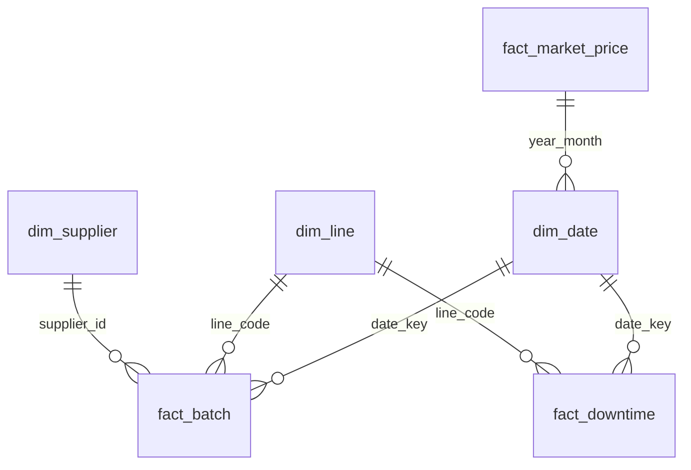

# Power BI Build Guide

This guide rebuilds the Power BI report from `data/processed/`. The steps take
about 2 to 3 hours. Every measure and query is already written in this folder,
so you only assemble them and design the pages.

> **Why is there no `.pbix` in the repo yet?** Power BI Desktop runs on Windows
> only. Build the report yourself with this guide and save it as
> `powerbi/Refinery_Operations.pbix`. Building it yourself is the point: you
> need to be able to explain every visual and measure in an interview.

---

## 0. Prerequisites

| Need | Where |
|---|---|
| Power BI Desktop (free) | Microsoft Store or microsoft.com/power-bi/desktop |
| Clean data | Run `python run_pipeline.py`, or use the CSVs already committed in `data/processed/` |

---

## 1. Load data with Power Query  (about 20 min)

1. **Home > Transform data > Manage Parameters > New**
   - Name `DataFolder`, Type **Text**, value = full path to `data\processed\` (with the trailing `\`)
2. For each block in `power_query/all_queries.m`:
   **New Source > Blank Query > Advanced Editor >** paste the block, then rename the query
   (`fact_batch`, `fact_downtime`, `dim_date`, `dim_line`, `dim_supplier`, `fact_market_price`).
3. **Close & Apply**.

The `fact_batch` query adds four analysis columns in M: *CPO FFA Band*, *DOBI Band*,
*Deo Temp Band* and *Quality Status*. You can point to these in an interview as
"transformations I did in Power Query".

> **Alternative source:** You can read `data/refinery.db` directly with the SQLite ODBC
> driver (Get Data > ODBC) and import the views `vw_batch_enriched`,
> `vw_supplier_scorecard` and so on. That shows you can connect Power BI to a database.

---

## 2. Build the data model  (about 15 min)

Open **Model view** and create these relationships. They are all many-to-one with
single-direction filtering:

| From (many) | To (one) |
|---|---|
| `fact_batch[production_date]` | `dim_date[date_key]` |
| `fact_batch[line_code]` | `dim_line[line_code]` |
| `fact_batch[supplier_id]` | `dim_supplier[supplier_id]` |
| `fact_downtime[event_date]` | `dim_date[date_key]` |
| `fact_downtime[line_code]` | `dim_line[line_code]` |
| `dim_date[year_month]` | `fact_market_price[year_month]` |

Then:
- Select `dim_date`, choose **Table tools > Mark as date table**, and pick `date_key`.
- Sort `dim_date[month_name]` by `month_no`, and sort `fact_batch[shift]` by `Shift Order`.
- Hide the foreign-key columns in the fact tables so report users only see the dimension columns.

---

## 3. Add the measures  (about 30 min)

1. **Home > Enter data**, name the table `_Measures`, and click Load.
2. Add each measure from `DAX_measures.dax`. Use **New measure**, paste it, and set its format:
   - `%` measures: Percentage, 2 decimals
   - `(MYR)` measures: Whole number, thousands separator
   - Intensities: 3 to 4 decimals
3. Put them in display folders 1 to 9 as labelled in the file (Model view > Properties > Display folder).
4. Delete the blank column in `_Measures`. The table icon becomes a calculator.

---

## 4. Apply the theme

**View > Themes > Browse for themes >** `refinery_theme.json`.
The theme uses a colour-blind-safe palette. Line A is blue, Line B is orange and Line C is green.

---

## 5. Design the report pages  (about 1.5 h)

Canvas size is 1280 × 720. Put the slicers in one row at the top of every page:
**Date range** (`dim_date[date_key]`, Between), **Line**, and **Supplier**.
Sync them across pages with **View > Sync slicers**.

### Page 1 · Executive Overview
| Visual | Fields |
|---|---|
| 5 × Card (new card visual) | `CPO Processed (t)`, `Refining Yield %`, `Off-spec Rate %`, `Gross Refining Margin (MYR)`, `Unplanned Downtime Hours`. Add `Yield MoM Change (pts)` as the reference label on the yield card |
| Line chart | X `dim_date[month_start]`, Y `Refining Yield %`, Legend `dim_line[line_name]`. Add a constant line at 95 % (Analytics pane) |
| Clustered bar | Y `dim_supplier[supplier_name]`, X `Refining Yield %`, sorted descending |
| Bar chart | Y `fact_downtime[category]`, X `Downtime Hours`, tooltip `Downtime Cumulative %` |
| Text box | Dynamic title with `Title Overview` (Format > Title > fx) |

### Page 2 · Quality & Process
| Visual | Fields |
|---|---|
| Scatter | X `deo_temp_c`, Y `rbdpo_ffa_pct`, Legend `line_code`, Details `batch_id`. Constant Y line at 0.10 labelled "Spec" |
| Matrix | Rows `line_name`, Columns `shift`, Values `Off-spec Rate %`. Conditional formatting: background colour scale from white to red |
| Column chart | X `Deo Temp Band`, Y `Off-spec Rate %` |
| 2 × Column chart, side by side | X `DOBI Band`. Chart 1: Y `Avg Bleaching Earth %`. Chart 2: Y `Avg Colour (R)`. Use two charts, **not** one dual-axis chart, because the two measures have different units |
| **Key influencers** (AI visual) | Analyze `Quality Status`, Explain by `deo_temp_c`, `deo_vacuum_mbar`, `cpo_ffa_pct`, `cpo_dobi`, `bleaching_earth_pct`, `line_code`, `shift`. This is data mining inside Power BI |
| Decomposition tree | Analyze `Off-spec Batches`, Explain by line, shift, supplier, Deo Temp Band |

### Page 3 · Supplier Analysis
| Visual | Fields |
|---|---|
| Table (scorecard) | `supplier_name`, `region`, `certification`, `CPO Processed (t)`, `Wtd CPO FFA %`, `Avg CPO DOBI`, `Refining Yield %`, `Off-spec Rate %`, `Margin per Tonne (MYR/t)`, `Supplier Yield Rank`. Add data bars on CPO and a colour scale on Yield |
| Scatter | X `Wtd CPO FFA %`, Y `Refining Yield %`, Size `CPO Processed (t)`, Details `supplier_name` |
| Bar chart | Y `supplier_name`, X `Supplier Opportunity (MYR)` |
| Line chart | X `month_start`, Y `Wtd CPO FFA %`, Legend `region`. Shade the peak crop season with `crop_season` as a background band or add a text annotation |

### Page 4 · Reliability & Energy
| Visual | Fields |
|---|---|
| Cards | `Availability %`, `MTBF (h)`, `MTTR (h)`, `Steam Intensity (t/t)`, `Power Intensity (kWh/t)` |
| Bar chart (Pareto) | Y `category`, X `Downtime Hours`, tooltip `Downtime Cumulative %`, sorted descending |
| Clustered column | X `line_name`, Y `Unplanned Downtime Hours`, Legend `category` |
| Line chart | X `month_start`, Y `Steam Intensity (t/t)`, Legend `line_name` |
| Table | Batches with high steam use: `batch_id`, `production_date`, `line_code`, `steam_per_mt_cpo`. Add a visual-level filter on `steam_per_mt_cpo` > 0.065 |

### Polish (this is what recruiters notice)
- Add a page navigator (**Insert > Buttons > Navigator > Page navigator**) along the left side.
- Write a one-line insight as the subtitle of every visual, for example "Line C runs about 2 °C colder, which causes most off-spec FFA".
- Add tooltip pages: a small page set as **Tooltip** that shows yield, FFA and off-spec for the hovered month.
- Add a bookmark that toggles between "All batches" and "Off-spec only".
- Keep a consistent number format everywhere (yield to 2 decimals, money in RM thousands or millions).

---

## 6. Publish and share

1. **File > Save as** `powerbi/Refinery_Operations.pbix`, then commit it to the repo (5 to 10 MB is fine).
2. **Export a PDF:** File > Export > PDF. Commit it as `powerbi/Refinery_Operations.pdf` so people
   without Power BI can still view the report.
3. **Screenshots:** Take one PNG per page and save them as `images/powerbi_page1.png` to `powerbi_page4.png`.
   Then replace the placeholder section in the main README. An animated GIF of you clicking
   through the slicers (made with ScreenToGif, which is free) works very well at the top of a README.
4. **Publish online (optional, pick one):**
   - **Power BI Service:** Home > Publish > My workspace. You need a work or school account,
     because Power BI Service usually does not accept personal Gmail or Outlook addresses.
     After publishing, use *File > Embed report > Publish to web* to get a public link, if your
     tenant admin allows it.
   - **NovyPro** (novypro.com): a free portfolio site for Power BI and Tableau dashboards that
     many analysts use.
   - Otherwise, use the interactive HTML dashboard in `dashboard/` with **GitHub Pages**
     (see the main README). Anyone can open it in a browser with no login.

Put the public link at the top of the README and on your CV and LinkedIn.
